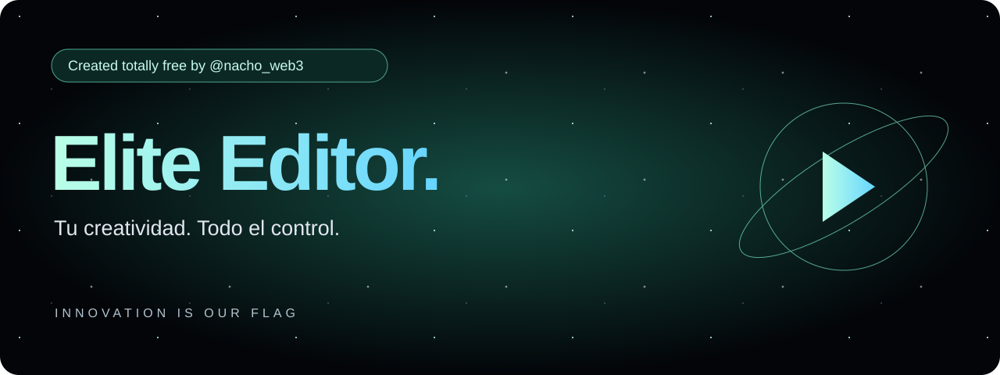

# Elite Editor



**Un editor de vídeo local y gratuito con timeline real y un asistente IA cuyas decisiones puedes revisar.**

Versión alfa temprana, orientada a Windows. Sin cuentas, pagos ni suscripciones. La generación externa opcional utiliza tu clave y los créditos de tu proveedor. La interfaz está principalmente en español.

## Instalar y abrir

Necesitas Git, Node.js 22+ y FFmpeg/ffprobe en PATH. Desde PowerShell:

```powershell
git clone https://github.com/nachoweb3/elite-editor.git
cd elite-editor
npm ci
npm exec --yes --package=bun@1.2.18 -- bun install --cwd vendor/opencut-classic --frozen-lockfile
npm run setup
npm run dev
```

Abre http://127.0.0.1:5181/projects. Después puedes usar `ELITE_EDITOR.cmd`. No cierres la terminal mientras editas. La preparación no descarga modelos ni incluye tus claves o grabaciones.

## Qué incluye

- Timeline de OpenCut adaptada: medios, capas, textos, recortes y keyframes.
- Zoom animado con rombos, selección de zona del lienzo y posición X/Y. Veinte estilos de texto editables organizados por uso.
- Asistente integrado: propuesta de cortes, subtítulos editables e instrucciones con revisión antes/después.
- Análisis local opcional con Whisper, FFmpeg y Ollama; retoque facial con MediaPipe y voz limpia.
- Limpieza manual de vídeo/voz y 14 controles de belleza, incluidos tamaños de ojos, nariz y boca en ambos sentidos. Procesamiento previo sobre una copia, con cuatro presets de partida.
- Diez efectos GPU, incluido chroma key; seis animaciones de entrada/salida y 188 audios CC0 preinstalados.
- Audio con categorías, búsqueda por autor/colección, orden por duración y favoritos locales.
- Explicaciones stickman que puedes revisar, quitar y componer en el render.
- Biblioteca con tu identidad de proyecto, universo animado y firma @nacho_web3.

## Primera edición

Lee la [guía introductoria completa](docs/GETTING_STARTED.es.md), también disponible en **Guía de primeros pasos** dentro de Mis proyectos.

Crea un proyecto y carga tu vídeo en Medios. Para editar manualmente, trabaja en la timeline. Para recibir ayuda, vincula la grabación en Asistente IA, analiza y revisa antes de añadir los cortes. Las instrucciones siguen el flujo **Mejorar instrucción → Ver qué cambiaría → Aplicar a la propuesta IA**. La propuesta y la timeline son estados diferentes: aplicar una instrucción no sustituye tus capas manuales.

Los modelos se instalan aparte. La [guía principal](README.md#optional-local-ai) explica cómo preparar Python, Whisper, Ollama y el modelo facial. La edición manual no necesita claves de IA.

## Límites claros

Esta alfa todavía no ofrece una sincronización completa entre todas las capas de OpenCut y el motor FFmpeg. Stickman y movimientos de cámara del motor aparecen en el vídeo procesado; no se convierten todavía en capas/keyframes nativos. Las entradas/salidas no son disoluciones entre clips solapados. Chroma key no equivale a segmentación automática de personas.

Los proyectos de timeline se guardan en el navegador y los originales del asistente en disco. No borres los datos del sitio sin copia de tu trabajo. Falta ampliar las pruebas de exportación en navegador con grabaciones largas y material real. El servidor actual es local, no una plataforma SaaS multiusuario.

## Participa

Queremos que la edición local gratuita sea útil por sí misma. Los servicios remotos son una posible extensión futura; **no hay sistema de pagos**. Puedes ayudarnos con una estrella, errores reproducibles, traducciones y contribuciones pequeñas que incluyan pruebas. Consulta la [hoja de ruta](docs/ROADMAP.md), [arquitectura](docs/ARCHITECTURE.md) y [licencias y atribuciones](THIRD_PARTY_NOTICES.md).

**Created totally free by @nacho_web3. Innovation is our flag.**
