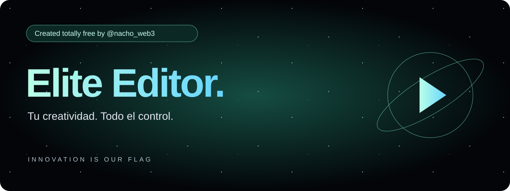

<p align="center"></p>

<p align="center"><strong>A local-first video editor with a timeline you control and an AI assistant you can review.</strong></p>
<p align="center"><a href="README.es.md">Español</a> · <a href="#quick-start-windows">Quick start</a> · <a href="docs/GETTING_STARTED.es.md">First-edit guide / Guía</a> · <a href="docs/ARCHITECTURE.md">Architecture</a> · <a href="docs/ROADMAP.md">Roadmap</a> · <a href="CONTRIBUTING.md">Contribute</a></p>

Elite Editor brings manual editing and local AI assistance into one workspace. Start with a blank timeline, or turn a long recording into a proposed cut, review it, and keep editing. Built on the work of OpenCut and the open-source community, with an integrated local processing backend.

**Early alpha. Windows-first. Free local editing. No account, subscription or payment system.** Optional external generation uses your own provider key and may incur provider charges. This repository is source code, not a hosted SaaS or a signed desktop installer.

## What you can do

- **Edit on a real timeline:** media, video/audio tracks, text, trimming, splitting and keyframes through the adapted OpenCut editor.
- **Ask for an edit, then review it:** improve an instruction, inspect before/after settings and proposed cuts, and apply the exact reviewed plan. Expired or stale plans are rejected.
- **Analyze locally:** silence detection with FFmpeg, optional Whisper transcription and optional Ollama-assisted editing.
- **Bring proposed cuts into the timeline:** import editable cuts and captions. Applying an enhanced source preserves linked clip timing and layers.
- **Improve the source:** optional local facial retouching, noise reduction and voice normalization. Keep the original and switch back.
- **Illustrate explanations:** review locally generated stickman concepts, remove unsuitable ones and render them as overlays or inserted segments.
- **Use bundled creative tools:** 10 GPU effects including chroma key, six entrance/exit presets and 188 bundled CC0 audio files (100 interface sounds, 85 jingles and three ambient variants).
- **Generate optional assets:** the Open Generative AI catalog adapter exposes selected image/video models through MuAPI. Local editing does not require a provider key.

The universe artwork above is brand artwork, not an application screenshot. We do not publish private project screenshots or claim features that have not been validated.

## Quick start (Windows)

Requirements: **Node.js 22+**, Git, **Bun 1.2.18** (or the `npm exec` command below), and **FFmpeg + ffprobe on PATH** for processing and audio registration. Use a modern browser with the media/GPU features required by OpenCut. Windows is the development target; other platforms are not yet release-tested.

```powershell
git clone https://github.com/nachoweb3/elite-editor.git
cd elite-editor
npm ci
npm exec --yes --package=bun@1.2.18 -- bun install --cwd vendor/opencut-classic --frozen-lockfile
npm run setup
npm run dev
```

Open **http://127.0.0.1:5181/projects**. After installation, `ELITE_EDITOR.cmd` starts the same editor. Keep the terminal running.

`npm run setup` creates local data directories and registers bundled audio using ffprobe. It preserves existing settings and projects. If FFmpeg is missing, install it and rerun setup. No AI models are downloaded by setup.

### Your first edit

1. Create a project from **Mis proyectos** and import a video into **Medios** for manual editing.
2. For assistance, select **Asistente IA**, upload/link an original recording and run analysis. AI workers require the optional setup below.
3. Review the proposed edit. **Añadir cortes y subtítulos a la timeline** appends editable clips; native Undo reverses the import.
4. Add text, effects or audio and export through the editor. Start with a short clip while evaluating the alpha.

UI language is currently primarily Spanish, with some inherited English labels.

### Optional local AI

Install Python 3.11, then create an isolated environment:

```powershell
py -3.11 -m venv runtime/venv
runtime/venv/Scripts/python.exe -m pip install -r requirements.txt
node scripts/model.mjs tiny
npm run doctor
```

`medium` is an explicit larger download: `node scripts/model.mjs medium`. The worker uses the installed model; it does not silently download weights. `ELITE_PYTHON` can point to another Python executable. An existing portable installation at `runtime/python/python.exe` is also supported.

For prompt editing, install [Ollama](https://github.com/ollama/ollama), then explicitly pull `qwen3:4b-instruct-2507-q4_K_M`. Ollama is expected at `127.0.0.1:11434`. Facial retouching additionally requires the [MediaPipe Face Landmarker model](https://ai.google.dev/edge/mediapipe/solutions/vision/face_landmarker#models) saved as `models/face_landmarker.task`. These downloads are optional and have their own terms and hardware requirements.

Auto-Editor is optional at `runtime/auto-editor.exe`; FFmpeg provides fallback silence cuts. The old Diffusion adapter is retained for source compatibility but its external application is not bundled or part of the supported setup.

## What runs where

| Component | Responsibility |
|---|---|
| `vendor/opencut-classic/apps/web` | Main Next.js editing interface on `127.0.0.1:5181` |
| `vendor/opencut-classic/rust` | Rust/WASM core, rendering and custom GPU effect shaders |
| `server` | Local Node API and job orchestration on `127.0.0.1:4310` |
| `workers` | Optional Python transcription, face processing and stickman drawing |
| `resources` | Bundled CC0 sound library with license files |
| `web` | Earlier editor retained for compatibility; `npm run dev:legacy` |

The main UI proxies `/nacho-api` to the local backend. Timeline projects and media use browser IndexedDB/OPFS; backend recordings/jobs live on disk. **Do not clear site data or switch browser/origin without exporting/backing up your work.** These are distinct storage systems, not cloud synchronization.

## Current boundaries

- **Two render paths:** browser timeline export and FFmpeg processing. Cuts/captions transfer; arbitrary timeline layers do not round-trip to FFmpeg.
- **Stickman and backend camera moves:** composed in backend renders, not yet imported as editable native layers/keyframes.
- **Entrance/exit animations are not cross-dissolves** between overlapping clips.
- **Chroma key is not AI person segmentation.** Facial processing still needs evaluation with real movement and occlusions.
- Long-recording performance, browser export reliability and recovery need broader real-world validation. Passing unit tests is not proof of a flawless 30-minute export.
- The backend is for **local, single-user use**. Do not expose it as a public multi-user service.
- The UI is based on archived OpenCut Classic; maintenance of this adaptation is the responsibility of this project. It is not an official OpenCut release.

## Development and checks

```powershell
npm test
npm run test:ui
npm run test:integration
cd vendor/opencut-classic/apps/web
node scripts/build-content.mjs
node ../../node_modules/typescript/bin/tsc --noEmit
```

The DOM test mocks editor/media internals and checks command/UI behavior; it is not a browser playback test. The integration test uses FFmpeg and synthetic media. See [architecture and rebuilding WASM](docs/ARCHITECTURE.md).

## Help shape the editor

We want an excellent free local editor before adding optional hosted services. There are no billing components in this release. See the [roadmap](docs/ROADMAP.md) for the next integration and reliability milestones.

If this direction is useful, **star the repository**, try a short edit, and open an issue with reproducible steps. Useful bug reports, accessibility improvements, translations and small tested contributions are welcome. Never attach confidential recordings, API keys or private project files to public issues.

## License and credits

Elite Editor's original contributions are released under **MIT**. Third-party code, packages, assets and optional models retain their respective licenses. This is not a claim that every dependency is MIT or unrestricted for every use. Read [THIRD_PARTY_NOTICES.md](THIRD_PARTY_NOTICES.md).

Built with gratitude to **OpenCut**, **Open Generative AI**, **CTBot000/face-beautifier**, **Kenney**, **James Gargette / cinameng**, and the broader FFmpeg, Whisper, MediaPipe and Ollama communities.

**Created totally free by @nacho_web3 — Innovation is our flag.**
